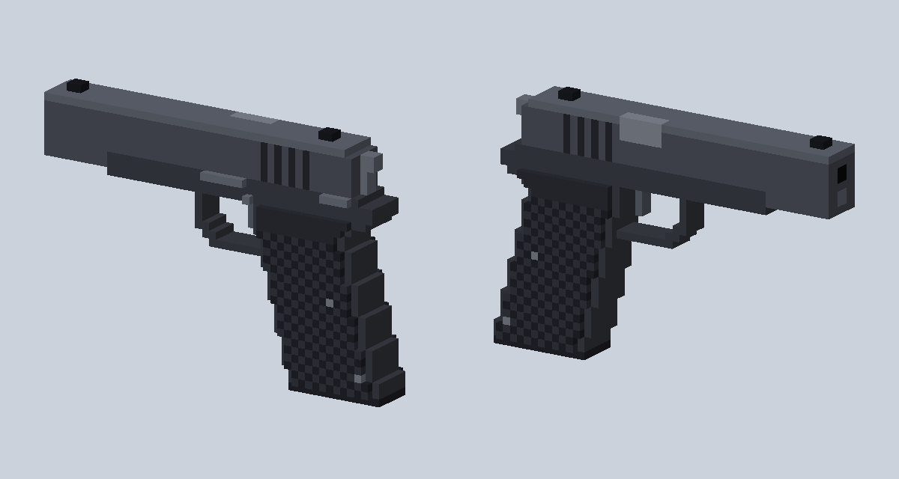

# Воксельные модели

Воксельные модели в стиле Minecraft. Каждая модель лежит в трёх видах:

- `<имя>.vox` — для MagicaVoxel (также открывается в Blockbench, Goxel, Blender с аддоном);
- `<имя>.obj` + `<имя>.mtl` — меш для Blender, Unity, Godot и т. п. (1 единица = 1 воксель, ось Y вверх);
- `<имя>.png` — рендер с двух сторон.

## CD-диск (`cd_disc`)

32×2×32, 1600 вокселей, 16 цветов. С одной стороны — блестящая поверхность с радужным бликом, с другой — этикетка.


## Пистолет Вайт Снейка (`whitesnake_pistol`)

48×8×33, 4771 воксель, 15 цветов, 1 воксель ≈ 4 мм. Пистолет Whitesnake из JoJo: Stone Ocean,
сделан по New Nambu M57A (вариант на базе M1911A1) в полностью серо-чёрной расцветке:
затвор с насечками, наклонная рукоятка с рифлёными накладками, курок, спусковая скоба.
На левой стороне — затворная задержка и предохранитель, на правой — окно выброса гильз.



## Перегенерация

Нужен только Python 3, без зависимостей:

```sh
python3 generate.py
```

Скрипт пересобирает все модели. Диск задаётся константами в начале `generate.py`,
пистолет — профилем `PISTOL_PROFILE` (один символ = один воксель), таблицей деталей `PISTOL_PARTS`
и списком односторонних деталей `PISTOL_DETAILS`.
