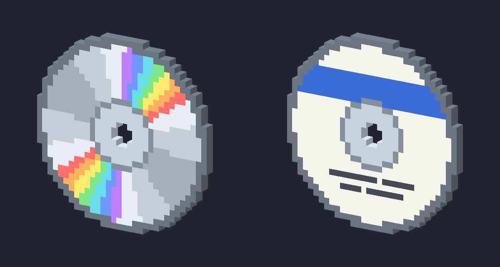

# Воксельный CD-диск

Воксельная модель компакт-диска в стиле Minecraft: 32×2×32 вокселя, 1600 вокселей, 16 цветов.
С одной стороны — блестящая поверхность с радужным бликом, с другой — этикетка.



## Файлы

- `cd_disc.vox` — модель для MagicaVoxel (также открывается в Blockbench, Goxel, Blender с аддоном).
- `cd_disc.obj` + `cd_disc.mtl` — меш для Blender, Unity, Godot и т. п. (1 единица = 1 воксель, ось Y вверх).
- `preview.png` — рендер обеих сторон.
- `generate.py` — генератор всех файлов выше.

## Перегенерация

Нужен только Python 3, без зависимостей:

```sh
python3 generate.py
```

Цвета, размеры колец и рисунок этикетки задаются константами в начале `generate.py`.
